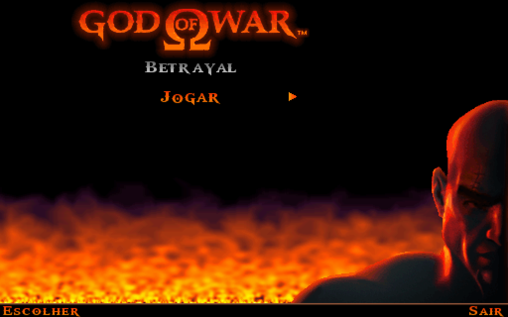
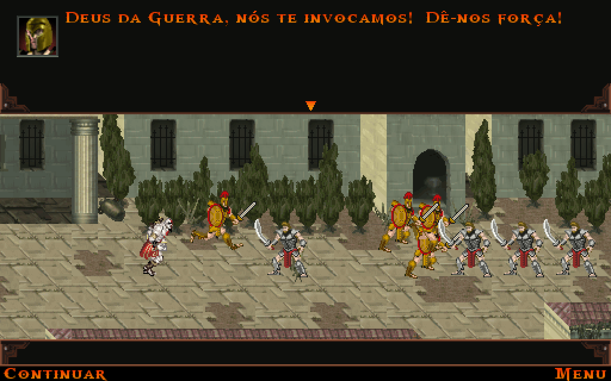

# God of War: Betrayal — port nativo

Port nativo do **God of War: Betrayal** (2007, celular Java ME) para **Windows**, **Linux** e **SteamOS**
(Steam Deck, Legion Go S e afins). Não é emulador genérico: o app tem a própria implementação
da plataforma do celular (tela, teclas, som MIDI e save) e roda o jogo direto, com ajustes
feitos especialmente para ele.

**O jogo não está incluído.** Você precisa do seu próprio arquivo `.jar` do God of War: Betrayal.
O app lê esse arquivo e aplica os ajustes na memória, na hora de carregar; nenhum código, imagem ou
som do jogo faz parte deste repositório.





## O que o port faz

- **Widescreen**: o jogo passa a "enxergar" uma tela na proporção do monitor (512x320 em 16:10) e mostra
  mais cenário dos lados. Feito trocando, no bytecode, a largura 240 (e a metade, 120, onde é centro de
  tela) por uma variável, com exceções onde esses números são índices de frase; as caixas de texto são
  recentralizadas e a tela de evoluir arma (desenhada para 240) é mostrada recortada. `--largura 240` volta
  ao formato original (em pé, com fundo desfocado nas laterais).
- Ampliação nítida ("sharp bilinear").
- Controle de verdade, com mapeamento que muda entre jogo e menus.
- Ritmo original de 25 fps, sincronizado com a tela quando ela tem um múltiplo próximo (120 Hz: um
  quadro a cada 5 atualizações = 41,7 ms). Rodar mais rápido muda a física, porque o motor arredonda
  contas com o tempo de cada quadro (e abaixo de 16 ms o jogo trava).
- VRR (G-SYNC / FreeSync) com `GOWB_VRR=1` (o Otavix Launcher liga por padrão): cada quadro vai direto para a
  tela, e os 25 fps passam lisos num monitor com VRR.
- Correção de um bug do relógio do motor original que deixava o jogo quase 2x mais rápido em
  máquinas rápidas.
- Música e efeitos MIDI com a SoundFont [GeneralUser GS](https://www.schristiancollins.com) (licença
  livre, incluída no pacote) e latência de 40 ms.
- Janela sem borda do tamanho da tela (no Modo Jogo do SteamOS, o modo exclusivo cai para 1920x1080).
- Tradução completa para o português do Brasil, com os acentos desenhados na própria fonte do jogo
  e as instruções adaptadas aos botões do controle (`--idioma en` volta ao inglês).

## Versão suportada

| Item | Valor |
|---|---|
| Jogo | God of War: Betrayal, v0.1.95, inglês, 240x320 |
| SHA-256 testado | `dce20b0b40e00f151f38f73ac788ac04174807add1974b398379fdbd19265366` |

Outros arquivos da mesma versão provavelmente funcionam; o app avisa no log (`logs\log.txt` no Windows,
`log.txt` no Linux) quando o arquivo é diferente do testado. A tradução só é aplicada quando a tabela de textos é idêntica à da versão testada.

## Como usar (Windows)

**Mais fácil:** instale o [Otavix Launcher](https://github.com/otavix010/otavix-launcher). Na página do
jogo, ele baixa este port, pede o seu `.jar` (copia para a pasta do port e confere a versão) e abre o jogo,
com as opções em menus (idioma, formato da imagem, ampliação, janela, sons).

Sem o launcher:

1. Baixe `gowb-port-windows-x64.zip` em Releases e extraia (já vem com o Java).
2. Coloque o `.jar` do jogo na pasta `jogo\`. Também dá para arrastar o arquivo para a janela, ou
   deixá-lo em Downloads ou na Área de Trabalho.
3. Abra `GoW Betrayal.exe`.

Controles e opções: veja o [LEIA-ME do Windows](pacote/LEIA-ME-windows.txt).

## Como usar (Linux / SteamOS)

1. Baixe `gowb-port-linux-x64.tar.gz` em Releases e extraia (já vem com o Java).
2. Coloque o `.jar` do jogo na pasta `jogo/`. Também dá para arrastar o arquivo para a janela, ou
   deixá-lo em `~/Emulation/roms/j2me`, `~/Downloads` ou na Área de Trabalho.
3. Rode `jogar.sh`. Na Steam: Modo Desktop → Adicionar um jogo não-Steam → `jogar.sh`.

Controles, opções e detalhes: veja o [LEIA-ME](pacote/LEIA-ME.txt).

## Como funciona

```
host/src/gowb/     app: janela (LWJGL/GLFW + OpenGL), controle, carregador do .jar,
                   ajustes de bytecode (ASM), tradução, acentos, ritmo por vsync
midp/src/          implementação própria das APIs do celular: javax.microedition.lcdui,
                   lcdui.game, rms, media (MIDI pelo sintetizador do Java), midlet
traducao/pt-BR.txt tradução (tabela|índice|texto)
pacote/            jogar.sh, LEIA-MEs, os scripts que montam os pacotes Linux e Windows com jlink,
                   e abrir.c (o GoW Betrayal.exe: abre o Java do pacote, log em logs\log.txt)
tools/             ferramentas de desenvolvimento (extração de textos, artes, montagem de prints)
```

Os ajustes aplicados no bytecode original (`Patcher.java`):

- recursos pedidos por `String.class.getResourceAsStream` passam a ler o `.jar` do jogo;
- relógio e `sleep` passam pelo app (permite testes determinísticos com relógio virtual);
- texto por índice passa pela tradução;
- a busca de glifo troca letras acentuadas pela letra base e o desenho do glifo acrescenta o acento;
- o tempo mínimo de quadro do motor (40 ms) vira configurável;
- o início do quadro é atualizado depois do `sleep` (o bug do relógio).

## Compilar

Requer JDK 21. Coloque em `lib/` os jars do LWJGL 3.4.3 (`lwjgl`, `lwjgl-glfw`, `lwjgl-opengl`, com
os `natives-linux` e os `natives-windows`) e o ASM 9.x, e rode `./build.sh`.

- Pacote Linux: `pacote/montar-linux.sh dist/gowb-port <jdk-21-linux> gowb-port-linux-x64.tar.gz`.
- Pacote Windows: `powershell -ExecutionPolicy Bypass -File pacote\montar-windows.ps1` (no Windows, com
  o JDK 21 no PATH, o Git Bash e o Visual Studio 2022 ou Build Tools com C++ e Clang). Sai
  `gowb-port-windows-x64.zip`.

Teste sem janela (relógio virtual, salva quadros em PNG):

```
java -jar dist/gowb-port/gowb.jar --headless --jogo jogo.jar --frames 600 --dump quadros --dump-every 60
```

## Licença

O código deste repositório está sob a [licença MIT](LICENSE). O pacote inclui o LWJGL e o ASM (BSD), a
SoundFont GeneralUser GS (licença em `sons/`) e um Java enxuto do Eclipse Temurin (GPLv2 com Classpath
Exception, avisos em `jre/legal`).

## Créditos

God of War é marca da Sony Interactive Entertainment. God of War: Betrayal foi produzido pela
Sony Online Entertainment e desenvolvido pela Javaground (2007). Este é um projeto de fãs, sem
fins lucrativos e sem relação com os detentores dos direitos.
